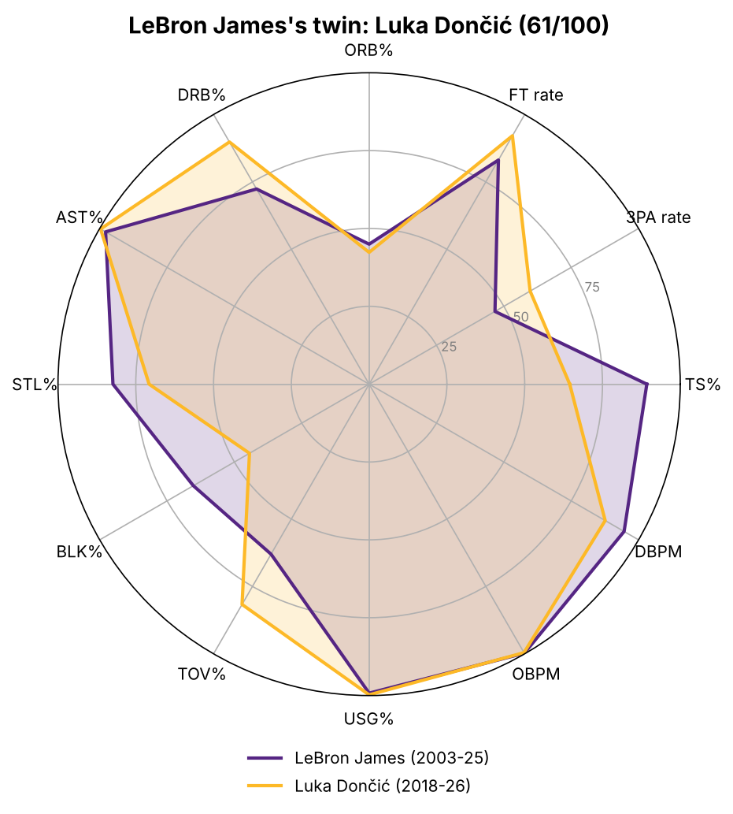
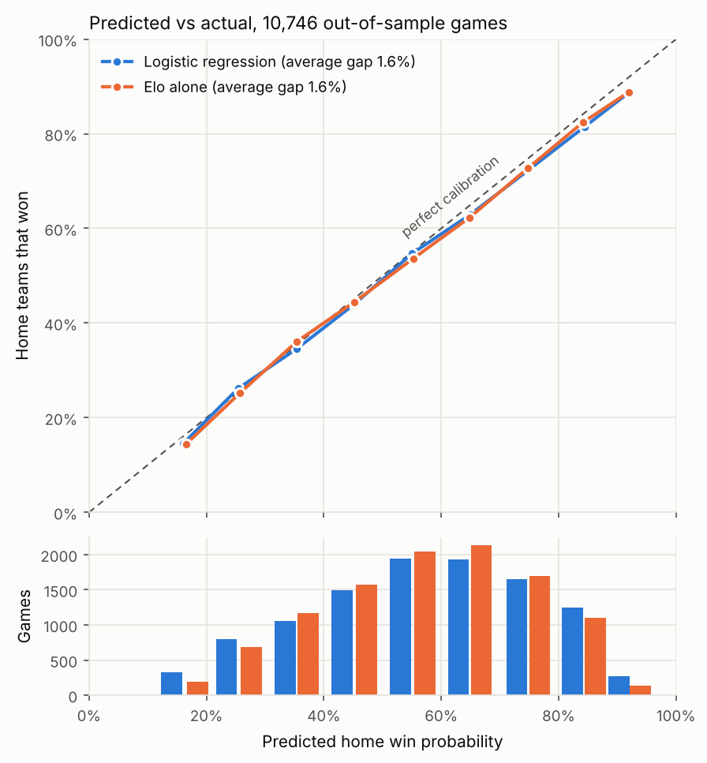
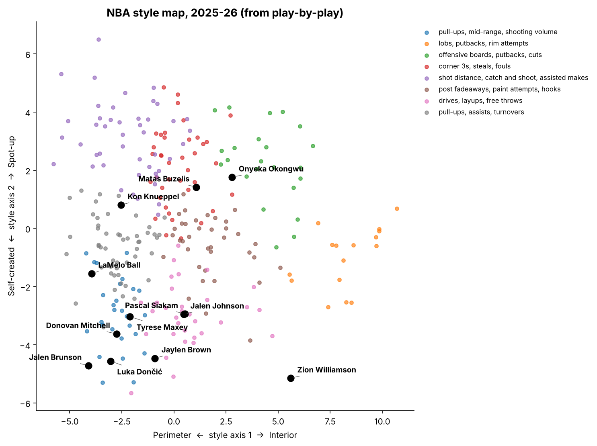
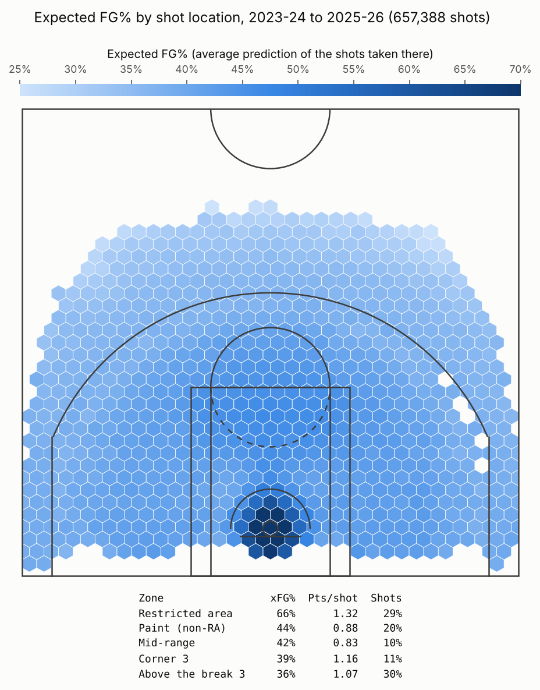
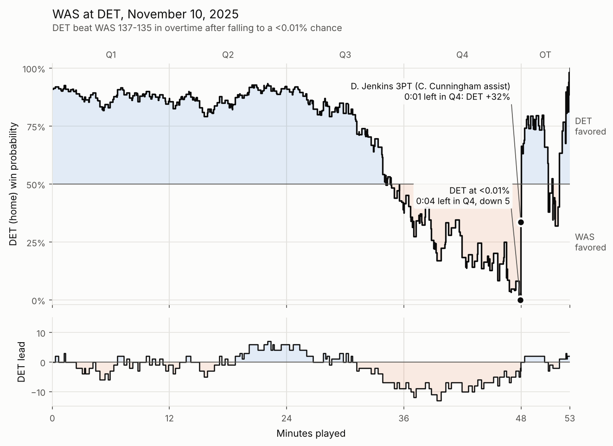
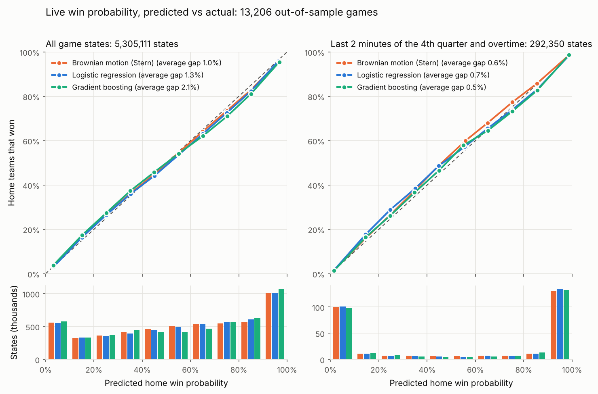
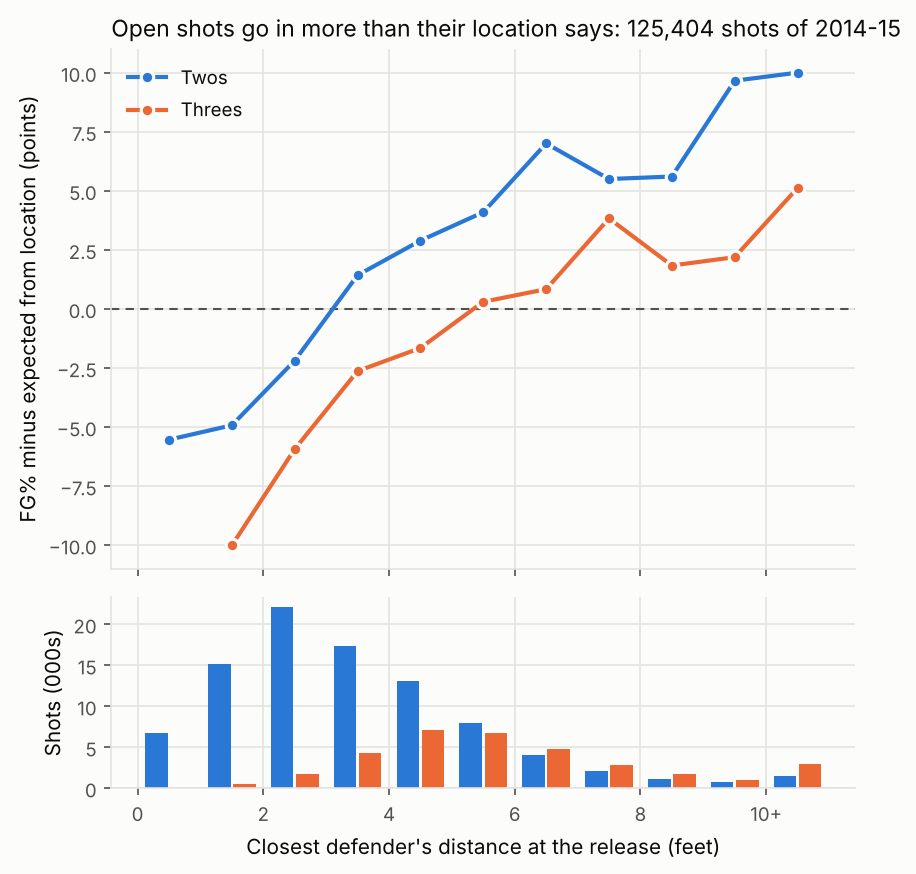

# basketball_ml

Machine learning on NBA data. Each project lives in its own module of the `basketball_ml` package and shares the same data loaders.

| Module | Status | What it does |
| --- | --- | --- |
| [`twins`](#statistical-twins) | Ready | Finds a player's "statistical twin" for a season or a whole career, across every era |
| [`projections`](#career-projections) | Ready | Projects a player's next seasons from what his twins did at the same age |
| [`predictions`](#game-predictions) | Ready | Home win probability for any matchup, from Elo, recent form, rest and who plays, benchmarked against closing betting lines, and live for the season in progress |
| [`embeddings`](#play-by-play-style) | Ready | Style fingerprints from play-by-play: style twins, archetypes and a style map |
| [`impact`](#player-impact-rapm) | Ready | How many points each player adds per 100 possessions (RAPM), and a next-season forecast that beats public metrics on a public benchmark |
| [`shots`](#shot-quality-expected-fg) | Ready | Expected FG% of every shot, shot making by player, and shot quality by team |
| [`winprob`](#live-win-probability) | Ready | Win probability after every play, the biggest comebacks, and win probability added by player, live for the season in progress |
| [`tracking`](#player-tracking) | Ready | What the arena cameras add: how open each shot was (from the 2014-15 shot logs and the raw 2015-16 positions), its effect on expected FG% and shot making, and the defenders who make shooters miss |

## Installation

```bash
python -m venv .venv && source .venv/bin/activate
pip install -e . pytest
pip install -e ".[tracking]"   # adds py7zr, only to read the raw 2015-16 tracking
```

### Data

Download `Advanced.csv` from the Kaggle dataset [NBA Stats (1947-present)](https://www.kaggle.com/datasets/sumitrodatta/nba-aba-baa-stats), or from its GitHub source, and put it in `data/`:

```bash
curl -L -o data/Advanced.csv https://raw.githubusercontent.com/sumitrodatta/bball-reference-datasets/master/Data/Advanced.csv
```

Play-by-play and shot charts come from the public GitHub repository [shufinskiy/nba_data](https://github.com/shufinskiy/nba_data), which covers every season since 1996-97. Game predictions, player impact and play-by-play style use these files. They download automatically into `data/pbp/` the first time they are needed (about 140 MB per season). The 2025-26 play-by-play only exists there in the cdn.nba.com format, so it is converted to the stats.nba.com layout on download. On 2024-25, where both formats exist, the converted data gives the same final score in 1,229 of 1,230 games and box-score totals within 0.3%.

Other public sources, also downloaded on first use:

- **Draft picks, birth dates and player ids**: [sumitrodatta/bball-reference-datasets](https://github.com/sumitrodatta/bball-reference-datasets) and the NBA.com to Basketball-Reference id table of [gabriel1200/site_Data](https://github.com/gabriel1200/site_Data), into `data/bref/` (impact forecast).
- **Hoop Impact Bench**: games and minutes of [lumahoops/hoop-impact-bench](https://github.com/lumahoops/hoop-impact-bench) (CC BY 4.0), into `data/bench/`.
- **Closing betting lines**: [kyleskom/NBA-Machine-Learning-Sports-Betting](https://github.com/kyleskom/NBA-Machine-Learning-Sports-Betting), into `data/odds/` (market benchmark).
- **The season in progress**: the NBA's live feed (schedule, box scores and today's odds, on the public bucket `nba-prod-us-east-1-mediaops-stats`), into `data/live/`.
- **Tracking shot logs of 2014-15**: published by the NBA's stats site and mirrored in public GitHub repositories such as [SergioLlana/nba-shot-analysis](https://github.com/SergioLlana/nba-shot-analysis), into `data/tracking/` (player tracking).
- **Raw tracking of 2015-16**: the SportVU positions of [linouk23/NBA-Player-Movements](https://github.com/linouk23/NBA-Player-Movements), read one game at a time; only the shot features are kept, in `data/tracking/sportvu/` (player tracking).

## Statistical twins



### Method

1. **Data**: Basketball-Reference advanced stats, one row per player and season, since 1979-80. Only seasons with at least 500 minutes are kept.
2. **12 style and efficiency stats**, independent of pace and playing time: TS%, 3-point attempt rate, free throw rate, ORB%, DRB%, AST%, STL%, BLK%, TOV%, USG%, OBPM, DBPM.
3. **Per-season standardization**: each stat becomes a z-score computed within its season, so a 2025 3-point rate can be compared with a 1995 one.
4. **Career profile**: the mean of a player's season z-scores, weighted by minutes played (10,000 career minutes minimum).
5. **Nearest neighbors**: Euclidean distance between profiles, converted into a score out of 100. A score of 100 means an identical profile; an average gap of half a standard deviation per stat gives about 61.

### Usage

```bash
# Career twins
basketball-ml twins "LeBron James" --radar outputs/lebron.png

# Single-season twins (2013 = the 2012-13 season)
basketball-ml twins "LeBron James" --season 2013 -k 5
```

Example output (career):

```
                 player  first_season  last_season  similarity
            Luka Dončić          2019         2026        60.5
           James Harden          2010         2026        53.7
            Dwyane Wade          2004         2019        53.2
Shai Gilgeous-Alexander          2019         2026        50.8
          Magic Johnson          1980         1996        49.3
```

The closest twin to LeBron's 2012-13 season is Michael Jordan's 1988-89 season (57.5/100), followed by Kevin Durant's 2013-14 (55.5/100).

From Python:

```python
from basketball_ml.data import load_advanced
from basketball_ml.twins import standardize_by_season, career_profiles, find_twins, resolve_player

z = standardize_by_season(load_advanced("data/Advanced.csv"))
careers = career_profiles(z)
find_twins(careers, resolve_player(careers, "Victor Wembanyama"), k=5)
```

## Career projections

To project a player, look at the players who looked most like him at the same age and see what they did next.

### Method

1. **Comparables**: the 50 player-seasons closest to the target season (same z-score profile as the twins module), among players of the **same age** whose later season is already known. Only seasons that ended before the target season can be used, so nothing leaks from the future.
2. **What happened next**: for each comparable, the raw change of each stat between that season and the one `h` years later (for example +1.2 BPM).
3. **Starting point**: half the current season, half a 3-season average weighted 5/4/3 by recency and by minutes (as in the Marcel projection system). One noisy season counts less.
4. **Projection**: the starting point plus the similarity-weighted average of the comparables' changes, for 1 to `h` seasons ahead.
5. **80% range**: the 10th and 90th weighted percentiles of the same changes, which show how differently players like him turned out.

### Usage

```bash
# Next three seasons (--last-complete-season skips a season still in progress)
basketball-ml project "Victor Wembanyama" --last-complete-season 2025

# Backtest against simple baselines
basketball-ml backtest --last-complete-season 2025
```

```
Victor Wembanyama, age 21 in 2024-25

          2024-25 (actual)  2025-26 (projected)  2026-27 (projected)  2027-28 (projected)
BPM                  6.500                6.563                7.169                7.587
OBPM                 3.600                3.611                4.044                4.223
DBPM                 2.900                2.969                3.138                3.371
TS%                  0.594                0.593                0.601                0.607
USG%                30.400               31.616               32.455               32.071

BPM 80% range (10th to 90th percentile of the comparables' outcomes):
  2025-26: +4.2 to +8.7
  2026-27: +4.7 to +9.6
  2027-28: +5.4 to +9.5
```

### Backtest

Each of the 3,958 player-seasons from 2010-11 to 2024-25 was projected one season ahead and compared with what actually happened. The comparables beat both baselines on all 13 stats. The baselines are "no change", which repeats the current season, and the "age curve", which adds the average change for that age.

| Mean absolute error | Comparables | Age curve | No change | Actual inside the 80% range |
| --- | --- | --- | --- | --- |
| BPM | **1.29** | 1.43 | 1.47 | 79% |
| OBPM | **1.11** | 1.21 | 1.25 | 80% |
| DBPM | **0.61** | 0.66 | 0.66 | 80% |
| TS% | **0.0296** | 0.0335 | 0.0337 | 78% |
| USG% | **2.07** | 2.14 | 2.19 | 76% |
| AST% | **2.81** | 2.94 | 2.97 | 75% |

What helped and what didn't:

| Change | BPM error | Kept |
| --- | --- | --- |
| Current season as the starting point | 1.37 | |
| **Half current season, half 3-season average** | **1.29** | Yes. The weight was picked on 2011-2017 and holds on 2018-2025 (1.36 → 1.29). |
| Blending the projection with the age curve | 1.37 or worse at every weight | No |
| Matching comparables on play-by-play style instead of box-score stats (2014+) | 1.35 vs 1.33 | No. Style identifies a player but doesn't predict his development better. |

Limits: the 3-point attempt rate range only holds 71% of the time, because its league-wide rise isn't in older comparables. Also, only players who stayed in the league with 500+ minutes have an outcome, so comparables are biased toward careers that continued.

## Game predictions

### Method

1. **Games**: final scores are the highest score reached in each game's play-by-play, and dates and home and away teams come from the shot charts. Regular season only, from 2012-13 to 2025-26 (16,895 games). The season in progress comes from the NBA's live feed (see [below](#the-season-in-progress)).
2. **Pre-game features**, computed only from earlier games:
    - **Elo** with a margin-of-victory multiplier and 25% regression to the mean between seasons, as in FiveThirtyEight's model. Its 100-point home edge is lowered to 60, because home teams win less often than they used to (about 59% of games until 2018-19, about 55% since).
    - **Form**: average margin over each team's last 10 games
    - **Season**: season-to-date average margin
    - **Rest**: days since each team's previous game, and back-to-back flags
    - **Lineup strength**: each team is expected to field the players of its previous game. A player who is hurt keeps missing games, so his absence carries over; one back from injury is missed once. Each player's production per game (points + assists + rebounds + steals + blocks - turnovers, from the play-by-play) is averaged over the season so far, falling back to last season until he has 3 games, and a team's strength is the sum over its 10 best players. A team's first game of a season has no previous game: its players stand in for the announced roster.
    - **Lineup impact**: the [RAPM](#player-impact-rapm) ratings of the same players, weighted by their usual minutes. Ratings are refit every 30 days during the season from the games already played plus the two previous seasons, with the offense and defense box-score prior, the luck adjustment and the forecast layer (rookies by draft pick and age, playing time, aging).
3. **Models**: logistic regression and gradient boosting on those features, trained on all earlier seasons and tested on the next one.

### Usage

```bash
basketball-ml tonight                         # today's games of the season in progress, next to the sportsbooks
basketball-ml tonight --date 2026-11-06 --out "Joel Embiid"   # another day, without injured players
basketball-ml predict SAS OKC --live          # any matchup, with the season in progress
basketball-ml predict SAS OKC                 # SAS (home) vs OKC at the end of 2025-26: SAS 56%, OKC 44%
basketball-ml predict SAS OKC --out-home "Victor Wembanyama"   # SAS drops to 44%
basketball-ml predict WAS OKC --next-season   # season opener: ratings regressed, form reset
basketball-ml ratings                         # Elo table after the last season loaded
basketball-ml games-backtest --market --calibration docs/calibration.png   # walk-forward evaluation
basketball-ml games-backtest --lineups played  # the same, knowing who played (only possible after the game)
```

### Backtest

Out of sample from 2017-18 to 2025-26 (10,746 games), with each season predicted by a model trained only on the seasons before it:

| Model | Accuracy | Log loss | Brier score |
| --- | --- | --- | --- |
| Always the home team | 55.9% | 0.687 | 0.247 |
| Elo alone | 65.1% | 0.622 | 0.217 |
| Logistic regression, without lineups | 65.6% | 0.620 | 0.216 |
| Logistic regression, with lineup strength | 66.0% | 0.616 | 0.214 |
| **Logistic regression, with lineup strength and impact** | **66.6%** | **0.612** | **0.212** |
| Gradient boosting, same features | 66.1% | 0.615 | 0.213 |
| *Logistic regression, knowing who played (not possible before the game)* | *67.4%* | *0.603* | *0.208* |

Lower log loss and Brier score are better. The lineup features add up: box-score strength alone gives a log loss of 0.6157, RAPM impact alone 0.6125, both 0.6116. 2025-26 was the most predictable of the nine test seasons (69.4% accuracy, log loss 0.585), and 2020-21 the least (63.2%, 0.635).

**Who plays.** Earlier versions of this table used the players who actually played in each game, on the grounds that injury reports announce absences before tip-off. That reached 67.4% and a log loss of 0.603, but it also knew about late scratches, coaches' decisions and who got minutes in a blowout, none of which is known before the game. With lineups from earlier games only, about half of what the lineup features seemed to add is gone. The regular rotation with no injury news at all does a little worse than the previous game (66.3%, 0.6154), and weighting each player by his chance of playing, given the games he just missed, does no better than the previous game (0.6117). Real injury reports sit somewhere between the previous game and knowing who played; this repo can't read them.

**Settings chosen on test seasons.** The Elo home edge was picked on 2017-18 to 2020-21 and the RAPM settings on 2015-16 to 2018-19, all inside or next to the test window. The logistic model barely depends on them: any home edge from 0 to 100 Elo points gives the same log loss (0.6116 to 0.6117), since the model learns its own home advantage. Only the "Elo alone" row is flattered: picked on 2015-16 and 2016-17 instead, the edge would be 80 and that row 0.626. On 2021-22 to 2025-26, after every season used for a choice, the model is 67.4% right with a log loss of 0.608 (6,150 games).

With the players who actually played, the better ratings of the [impact module](#player-impact-rapm) (offense and defense prior, luck adjustment, forecast layer) had cut the log loss from 0.6058 to 0.6027, and refreshing them every month had raised accuracy by 0.3 points. A "missing production" feature (the summed production of regulars not expected to play) adds nothing on top of lineup strength (0.6116 with or without it), so it isn't used. Neither did travel: the distance each team flew since its previous game, time zones crossed, consecutive road games and the altitude of Denver and Utah together moved the log loss by 0.0002.

### Calibration

A win probability is only useful if it means what it says: games predicted at 70% should be won about 70% of the time.



Both models track the diagonal, with an average gap of 1.6 points between the predicted and the actual win rate. On 2017-18 to 2024-25, Elo with FiveThirtyEight's 100-point home edge was off by 6 points on average, because it kept favoring home teams as if it were still 2013. Lowering the edge to 60 points fixed its calibration and its log loss (0.635 to 0.626). The logistic model still overrates home teams by about 1.5 points, since each season's drop in home advantage can't be learned from the seasons before it. Weighting recent seasons more (half-life of 3 seasons) cut that bias to 1.0 point but barely moved the log loss (by 0.0008, in an earlier version of the model), so it isn't used.

### Against the betting market

Closing betting lines are the hardest benchmark: they know everything public before tip-off, injuries included. `games-backtest --market` scores the model against the closing moneylines of Sportsbook Review, from the public file of [kyleskom/NBA-Machine-Learning-Sports-Betting](https://github.com/kyleskom/NBA-Machine-Learning-Sports-Betting), with the bookmaker's margin removed. They cover 10,054 of the 10,746 test games (2025-26 only until January 7):

| | Accuracy | Log loss | Brier score |
| --- | --- | --- | --- |
| Closing line | 67.5% | 0.6007 | 0.2070 |
| Model | 66.2% | 0.6156 | 0.2135 |
| Model given the closing line as one more feature | 67.4% | 0.6008 | 0.2071 |

The market is better in all 9 seasons, by 0.0149 in log loss (paired standard error 0.0019). When the two disagree by more than 10 points, the market is almost always right: in the 1,196 games where the model gave the home team 10+ points more than the line (59% against 43% on average), the home team won 44%; in the 712 where the line was 10+ points higher (65% against 50%), it won 64%. Most of those gaps are what the model can't see: injury news, minutes limits and rest decisions. The model adds nothing to the line: with the line's log-odds as a feature, the log loss is 0.6008, against 0.6007 for the line alone. The small gain reported before (0.0007) came from knowing who played.

### The season in progress

The play-by-play archives are published after each season, so the season being played comes from the NBA's public live feed: the JSON files of its own sites, on a public S3 bucket (league schedule with scores, each finished game's box score and play-by-play, and today's odds from several sportsbooks). The play-by-play is in the cdn.nba.com format, converted like 2025-26's. `tonight` and `predict --live` bring Elo, form, rest and the lineups up to the last game played, and refit the player ratings from the season's own stints, as in the backtest: every 30 days for past games, and through the last game played for upcoming ones. Files of finished games are cached in `data/live/`.

Through November 4, 2026, the 121 games of 2026-27 predicted that way (from the games before each one, each team with the players of its previous game) went 66.9% right with a log loss of 0.610; Elo alone was 60.3% right (log loss 0.632). That's too few games to be sure of either number: the 95% intervals, from resampling the games, are 58.7% to 75.2% for the accuracy and 0.540 to 0.680 for the log loss, and the model's edge over Elo (0.023) goes from -0.050 to +0.007. For November 6, 2026, before two of the games had odds:

```
          home win sportsbooks   elo lineup impact rest
game
WAS @ ATL      79%           -  +291          +5.6   +0
BOS @ CHA      34%           -   -84          -5.7   +0
PHI @ CLE      59%         44%   +67          +1.9   +0
UTA @ DAL      73%         69%  +184          +1.2   +0
OKC @ MEM      40%         39%  -174          -4.7   +0
TOR @ MIL      29%         30%  -136          -6.7   +0
MIN @ NOP      33%         39%   -94          -8.0   +0
POR @ LAL      65%         57%   +93          +2.8   +0
SAS @ SAC      12%         12%  -273         -15.1   +0
```

Each team is expected to field the players of its latest game; the model can't see injury news, so list players who won't play with `--out`. A gap like Cleveland's 15 points is more likely news the model lacks than an edge.

## Play-by-play style



Box scores say how much a player produces. Play-by-play shows **how** he plays: where he shoots from, which kind of shots, how often his makes are assisted, how he turns the ball over.

### Method

1. **34 style features** per player-season (300+ shot attempts), all shares or rates, so they don't depend on playing time:
    - **Touches**: field goal attempts, free throws, assists, offensive and defensive rebounds, steals, blocks, turnovers, fouls and fouls drawn, each as a share of the player's total involvement
    - **Shot diet**: share of attempts at the rim, in the paint, from mid-range, from the corners and above the break, plus dunks, layups, putbacks, floaters, hooks, post fadeaways, pull-ups, drives, cuts, lobs and catch-and-shoot jumpers
    - **Shot making**: field goal percentage by zone, shrunk toward the league average
    - **Creation**: share of made shots that were assisted, share of turnovers that were bad passes, average shot distance
2. **Per-season z-scores**, as in the twins module.
3. **Archetypes**: k-means clusters, each named by its three most distinctive traits.
4. **Style map**: the two main axes of the features (PCA). One runs from perimeter to interior, the other from self-created to spot-up. The map labels the highest-volume shooter of each archetype plus the next biggest names.
5. **Compact embedding**: an autoencoder squeezes the 34 features into 8 numbers.

### Usage

```bash
basketball-ml style-twins "Stephen Curry"         # closest styles since 2013-14
basketball-ml archetypes --season 2026 --map docs/style_map_2026.png
basketball-ml style-backtest --last-season 2025 --advanced data/Advanced.csv
```

```
Closest play-by-play styles to Stephen Curry in 2025-26:

  Bradley Beal               2016-17  similarity 55.0
  Evan Fournier              2019-20  similarity 53.7
  Dennis Schroder            2019-20  similarity 52.7
```

### Does it capture a player's identity?

Here's the test: take a player's season, then look among every player's **next** season for the closest one. The question is whether his own next season comes out first. There are 2,254 player-seasons from 2013-14 to 2023-24, each picked from about 270 candidates.

| Vector | Own next season found first | In the top 5 |
| --- | --- | --- |
| Box-score advanced stats (12, from the twins module) | 47.4% | 74.9% |
| **Play-by-play style (34)** | **65.8%** | **87.9%** |
| Both | 69.9% | 90.2% |
| Style compressed to 8 numbers (PCA) | 44.7% | 76.6% |
| Style compressed to 8 numbers (autoencoder) | 41.3% | 72.2% |

Play-by-play style is a much stronger fingerprint than box-score rates. Compressing it to 8 numbers keeps 78% of its variance, but it loses what makes each player unique. That's why style twins use the full 34 features, while the 8-number embedding is kept for maps and clustering.

## Player impact (RAPM)

How many points does a player add to his team per 100 possessions, once you account for who he shares the court with? Regularized adjusted plus-minus (RAPM) answers it from the play-by-play, helped by the box score, the draft and age.

### Method

1. **Who is on the court.** The play-by-play lists substitutions but not who starts each quarter, so the starters of a quarter are the players whose first appearance in it isn't being subbed in. This works for 99.7% of quarters; the rest (a player who never touches the ball for a whole quarter) are skipped. Events are kept in file order, because event numbers are often out of order around substitutions.
2. **Stints.** Each stretch with the same ten players gives the points each team scored and its possessions (`FGA + 0.44 FTA - OREB + TOV`). That's 853,000 stints from 2012-13 to 2025-26.
3. **Ridge regression.** Each stint is two observations, one per team on offense: points per 100 possessions = league average + home edge + the 5 offensive players' O ratings + the 5 defenders' D ratings, weighted by possessions. Ridge shrinks every rating toward a prior, so players with few minutes or always sharing the court with the same teammates don't get wild values. Ratings use two seasons, the older one at 71% weight.
4. **Offense and defense box-score priors.** Each player is shrunk toward a box-score estimate of his offensive and of his defensive rating instead of toward average. Box scores come from the play-by-play (rebounds split into offensive and defensive by the team of the last miss). His per-100-possession rates of 2- and 3-point makes and attempts, free throws, assists, offensive rebounds, turnovers and fouls drawn on offense, and of defensive rebounds, steals, blocks and fouls on defense, plus his minutes per game, are mapped to the rating scale by regressing plain offensive and defensive RAPM on them (every rate is available to both). With a better prior, RAPM leans on it more (`alpha = 8000` instead of 4000). Shot zones and the share of assisted baskets added nothing.
5. **Luck adjustment.** Free throws count as the shooter's expected makes, and for the defensive ratings the opponents' threes count as expected makes too: a defense has little control over whether open threes go in, and opponent 3-point percentage takes thousands of attempts to mean anything. Each shooter's percentages come from the other half of the season's games, padded with 450 league-average threes and 24 free throws. Offense keeps its actual threes, since shooting is a skill. This is the recipe of [OpenRAPM](https://github.com/bbstats/openrapm).
6. **Forecast for the next season.** Ratings describe the past. To forecast, three corrections are learned each season from the earlier ones (the margin of every stint that last season's ratings leave unexplained, regressed on player features): players without a rating get a value from their draft pick and age, players rated from few possessions are moved down (`possessions / (possessions + 1000)`), and young players up and old ones down. Learned through 2025-26: a 19-year-old first pick is worth -0.7, a 20-year-old 10th pick -2.3 and an undrafted 23-year-old -2.6, but an undrafted 27-year-old (often a veteran of another league) -0.6; a player rated from 300 possessions loses 1.6 points and one rated from 8,000 gains 0.6; a 21-year-old gains 1.3 points on a 33-year-old. Draft picks, birth dates and NBA.com-to-Basketball-Reference ids come from public GitHub mirrors ([sumitrodatta/bball-reference-datasets](https://github.com/sumitrodatta/bball-reference-datasets), [gabriel1200/site_Data](https://github.com/gabriel1200/site_Data)), downloaded into `data/bref/` on first use.
7. **Tuning.** The shrinkage, the window, the prior's features and shrinkage (300 possessions), the share of 3-point luck removed and the rating of unrated players (-1.5) were chosen on 2015-16 to 2018-19, by how well each season's ratings explain the next season's game margins. The forecast's features were picked after looking at every season, so its edge in the tables below is a little optimistic.

### Usage

```bash
basketball-ml impact                      # leaderboard over the last two seasons, with next season's forecast
basketball-ml impact "Victor Wembanyama"  # one player, with his rank
basketball-ml impact --season 2016 --top 5
basketball-ml impact-backtest             # every rating method, season by season
basketball-ml impact-export               # forecasts for every season, as season,nba_id,rating
basketball-ml impact-bench                # score the forecasts on the Hoop Impact Bench test
```

2024-25 and 2025-26, players with 3,000+ offensive possessions:

| | Player | Offense | Defense | RAPM | 2026-27 forecast |
| --- | --- | --- | --- | --- | --- |
| 1 | Nikola Jokić | +7.3 | +1.2 | +8.4 | +8.5 |
| 2 | Shai Gilgeous-Alexander | +6.7 | +1.6 | +8.3 | +8.8 |
| 3 | Victor Wembanyama | +2.3 | +5.0 | +7.3 | +8.3 |
| 4 | Giannis Antetokounmpo | +5.3 | +0.7 | +6.0 | +5.9 |
| 5 | Kawhi Leonard | +4.6 | +1.2 | +5.8 | +5.4 |
| 6 | Luka Dončić | +5.1 | +0.3 | +5.4 | +5.9 |
| 7 | Donovan Mitchell | +3.9 | +0.7 | +4.6 | +4.8 |
| 8 | Tyrese Haliburton | +4.1 | +0.4 | +4.5 | +4.9 |
| 9 | Chet Holmgren | +1.4 | +3.1 | +4.5 | +5.2 |
| 10 | Jarrett Allen | +2.6 | +1.8 | +4.3 | +4.7 |

Defensive players (Wembanyama, Holmgren, Derrick White, Alex Caruso) rank much higher than in box-score metrics, which is the point of plus-minus models; the flip side is that a role player on a great team can get credit for the stars around him, and two seasons is still a small sample. The forecast moves young players up (Wembanyama, Holmgren, Ausar Thompson) and older ones down (Stephen Curry, Jimmy Butler, Kawhi Leonard).

### Does it work?

Ratings from the two previous seasons, applied to the players actually on the court in each stint, explain this share of the variance of every game's final margin (2015-16 to 2025-26, 13,206 games):

| Rating | Margin explained | Best in |
| --- | --- | --- |
| **Forecast: RAPM + rookies, playing time and age** | **17.8%** | 9 of 11 seasons |
| RAPM, offense/defense box-score prior, luck-adjusted | 16.8% | 2 |
| RAPM, offense/defense box-score prior | 16.4% | |
| RAPM, one box-score production prior (previous version) | 15.4% | |
| RAPM shrunk toward average | 14.6% | |
| Box-score production per game | 12.0% | |
| Raw on-court net rating | 11.3% | |
| Adjusted plus-minus without shrinkage | 11.1% | |

Each step helps in most seasons: the offense/defense prior in 10 of 11, the luck adjustment in 9 of 11 and the forecast in 9 of 11. The forecast's corrections are learned from earlier seasons only, so they are weak in the first test seasons (learned from one to three seasons) and worth about 2 points from 2020-21 on.

**Against public metrics.** [Hoop Impact Bench](https://github.com/lumahoops/hoop-impact-bench) scores public impact metrics on the same test: preseason ratings weighted by the minutes players actually played, 7,230 games from 2020-21 to 2025-26. Under its "established players" rule, everyone with fewer than 250 minutes the season before counts as -2.0; the "full forecast" uses each metric's own values for rookies too:

| Metric | Established players | Full forecast |
| --- | --- | --- |
| **basketball_ml forecast** | **.182** | .188 |
| LOKI | .170 | **.196** |
| Pulse | .171 | .177 |
| OpenRAPM | .162 | .171 |
| xRAPM | .161 | .169 |
| LEBRON | .159 | .154 |
| EPM | .157 | .178 |
| DARKO | .155 | .159 |
| BPM (Basketball-Reference) | .154 | .154 |
| Last season's plain RAPM | .141 | .133 |

Other metrics' numbers are the benchmark's published v1.1.0 results. Ours come from `impact-bench`, a re-implementation of its game-margin test on its own game and minutes files, which gives exactly its published numbers for the metrics it ships (LOKI, OpenRAPM, ARC). The benchmark calls gaps under about .006 noise, so on established players the forecast is ahead of every published metric; with rookies counted, LOKI's newcomer values are better than ours.

## Shot quality (expected FG%)



Two players can both shoot 47%, one on layups and the other on step-back threes. Expected FG% (xFG) is the chance that an average NBA shooter makes a shot, judged from the shot alone. Actual points minus expected points is shot making.

### Method

1. **Shots**: every field goal attempt in the shot charts since 2012-13, 2.9 million in all.
2. **Features**: only the shot, never the shooter.
    - Distance, location and angle, 2 or 3, and the three NBA zone fields.
    - The shot type (`ACTION_TYPE`); labels with fewer than 200 attempts are grouped as "other".
    - Period, seconds left, and an end-of-period heave flag (30+ feet with 3 seconds or less left).
    - The shooting team's lead before the shot, from the play-by-play (matched for 99.98% of shots).
3. **No result in the labels**: "bank" is dropped from shot types, because scorers mostly call a shot a bank shot when it goes in. Bank shots from 3 to 25 feet go in 11 to 19 points more often than other shots from the same distance. Labels renamed in 2015-16 ("Slam Dunk", "Tip Shot") are merged.
4. **Model**: gradient boosting with native categorical splits. Each season from 2015-16 to 2025-26 is predicted by a model trained on the 3 seasons before it, so every xFG is out of sample.
5. **Shot making**: points per shot minus expected points per shot (xFG × 2 or 3).
    - xFG is first set to each season's league level, separately for twos and threes, because 2-point accuracy has risen almost every season.
    - Twos are also corrected for each arena's scorekeeper bias. Some arenas log shots farther from the rim than they were, so twos there go in more often for both teams. The bias, estimated from home-minus-road gaps, ranges from -7 to +6 FG% points in 2025-26; Utah, Golden State and Sacramento are highest.
    - Each player's rate is shrunk toward 0 by the noise of his sample (empirical Bayes). Half of the observed spread is skill at about 270 attempts.
6. **Teams**: shot quality is the average expected points per shot (xPPS) of a team's attempts, and, on defense, of its opponents' attempts.

### Usage

```bash
basketball-ml xfg-backtest --chart docs/xfg_court.png   # walk-forward evaluation, calibration, chart
basketball-ml shot-making                                # best shot makers of 2025-26
basketball-ml shot-making "Stephen Curry"                # one player, season by season
basketball-ml shot-making --persistence                  # is shot making a skill?
basketball-ml shot-quality --season 2026                 # teams, offense and defense
```

The first run takes about 10 minutes. It caches the out-of-sample predictions for all 2.3 million shots in `data/pbp/xfg_predictions_2013_2026.csv`; after that every command takes a few seconds.

2025-26, players with 300+ attempts:

| | Player | FGA | FG% | xFG% | Points added | Per 100 shots (shrunk) |
| --- | --- | --- | --- | --- | --- | --- |
| 1 | Nikola Jokić | 1,132 | 56.9% | 46.6% | +243 | +17.5 |
| 2 | Luke Kennard | 443 | 53.3% | 43.3% | +115 | +14.9 |
| 3 | Shai Gilgeous-Alexander | 1,321 | 55.3% | 47.1% | +230 | +14.6 |
| 4 | Kevin Durant | 1,376 | 52.0% | 44.3% | +239 | +14.5 |
| 5 | Jakob Poeltl | 310 | 70.0% | 59.8% | +63 | +13.0 |
| 6 | Jamal Murray | 1,360 | 48.3% | 42.3% | +213 | +12.9 |
| 7 | Cam Spencer | 556 | 47.3% | 40.0% | +112 | +12.5 |
| 8 | Luka Dončić | 1,457 | 47.6% | 41.8% | +184 | +10.4 |
| 9 | Bobby Portis | 750 | 48.8% | 43.6% | +105 | +10.0 |
| 10 | Kon Knueppel | 1,084 | 47.5% | 42.9% | +142 | +10.0 |

Teams: Oklahoma City had the best net in 2025-26, scoring 1.12 points per shot on shots worth 1.10 and allowing 1.04 on shots worth 1.07. Denver had the best offense (1.15 points per shot) on below-average shots (1.07 expected), thanks to the most shot making in the league (+0.08 per shot). Across 2015-16 to 2025-26, about a quarter of the spread in teams' points per shot comes from shot quality and three quarters from shot making, on offense (24%) and on defense (26%).

### Does it work?

Out of sample, 2015-16 to 2025-26 (2.3 million shots), each season predicted from the three before it:

| Model | Log loss | Brier score | AUC |
| --- | --- | --- | --- |
| League FG% (no model) | 0.691 | 0.249 | 0.507 |
| League FG% by zone | 0.660 | 0.234 | 0.630 |
| Logistic regression, distance + 3-point flag | 0.664 | 0.236 | 0.634 |
| Boosting, location + game situation | 0.650 | 0.229 | 0.644 |
| + shot kind (dunk, layup, hook, tip, jumper) | 0.641 | 0.226 | 0.651 |
| **+ shot type (xFG model)** | **0.635** | **0.223** | **0.663** |

Lower log loss and Brier score are better. The xFG model is the best in every season. Sorted into tenths by xFG, predicted and actual FG% are 0.8 points apart on average, and 0.4 points in 2024-25 and 2025-26. The score margin adds nothing measurable (log loss 0.6368 with it, 0.6366 without, in 2025-26).

The shot type looks more useful in 2015-16 and 2016-17 (AUC 0.68) than it is. Before 2017-18, scorers gave made shots the detailed labels (pull-up, driving, step back) more often than misses. In 2012-13, 83% of missed twos from 10+ feet were plain "Jump Shot", against 70% of makes; by 2022-23 the two shares were within a point. The detail adds 0.04 AUC over the coarse shot kind in 2015-16, but only 0.003 to 0.005 since 2022-23. Models trained on those early seasons also overrate shots by 1.5 to 2.4 points through 2018-19, so shot making before 2019-20 is less reliable.

**Is shot making a skill?** 2,034 players with 300+ attempts in two consecutive seasons, 2015-16 to 2025-26:

| Year-to-year correlation | r |
| --- | --- |
| FG% | 0.823 |
| eFG% | 0.635 |
| xFG% (shot diet) | 0.917 |
| FG% above expected (shot making) | 0.634 |
| Points added per 100 shots | 0.602 |

Shot making holds up from one season to the next as well as eFG% does: it is a skill, not luck. On its own, though, it predicts next season's FG% poorly (r 0.26, against 0.82 for last season's FG%). Most of a player's FG% is his shot diet, and that barely changes. The two parts work best together:

- Last season's xFG% and shot making, weighted separately, predict next season's FG% better than last season's FG% (error 3.28 vs 3.40 points, each pair of seasons predicted from the others).
- Last season's shot making predicts next season's shot making much better than FG% does (r 0.63 vs 0.28).

How open each shot was isn't in the shot charts. The 2014-15 tracking logs and the raw 2015-16 positions show that it matters for xFG but changes little about who the good shot makers are (see [Player tracking](#player-tracking)). Free throws are left out, so players get no credit for drawing fouls.

## Live win probability



The home team's chance of winning after every event of a game, and the players whose plays moved it. Above, the biggest comeback of 2025-26: Detroit, down 5 to Washington with 4 seconds left, was given less than a 0.01% chance before two Daniss Jenkins threes forced overtime. It won 137-135.

### Method

1. **Game states**: one per event, with the time left (in regulation, or in the current overtime), the home lead, who has the ball, and the pre-game Elo probability of the [game predictions](#game-predictions), also as a point spread (Elo gap / 28). 6.8 million states in 16,895 games from 2012-13 to 2025-26.
2. **Who has the ball** is inferred from the order of events. Made baskets, defensive rebounds, turnovers and last made free throws switch it; a miss leaves it loose until the rebound. Shooting fouls send the team to the line with the free throws awarded. Technical free throws don't change possession, and after flagrant, clear-path and take fouls the shooting team keeps the ball. After jump balls and at the start of quarters the ball goes to the team that acts next, because the recorded tip is often wrong.
3. **Models**, each season fit only on the seasons before it:
    - **Brownian motion** ([Stern, 1994](https://www.jstor.org/stable/2290952)): the final margin is the current one, plus the value of the ball, plus the pre-game spread times the share of the game left, plus normal noise that shrinks with the time left. The noise, possession values, spread weight and a clock offset are fit by maximum likelihood.
    - **Logistic regression** on the margin and possession divided by the square root of the time left, and the pre-game logit times the time left and its square root.
    - **Gradient boosting** on the raw state, increasing in the margin, the spread and the ball.
4. **Win probability added (WPA)**: each event's change in win probability, including the time that ran off before it, goes to the players on it: the shooter (70/30 with the passer, half to the blocker on a block), free-throw shooter, rebounder, ball handler (half to the stealer) and fouler, who is charged for the free throws he gives. **Clutch** is the NBA's definition: the last 5 minutes of the 4th quarter or overtime with the margin within 5.

### Usage

```bash
basketball-ml winprob-backtest --calibration docs/winprob_calibration.png   # walk-forward evaluation
basketball-ml winprob-game --biggest-comeback --season 2026 --out docs/winprob_game.png
basketball-ml winprob-game 22500199     # any game id, saved to outputs/winprob_22500199.png
basketball-ml winprob-live              # 2026-27 games of the last day played, finished or in progress
basketball-ml winprob-live 22600175     # one game of the season in progress
basketball-ml wpa --season 2026         # leaderboard; --clutch, or --on-court for team WPA while on the court
```

The first run takes about 25 minutes and caches game states and out-of-sample probabilities in `data/pbp/winprob_*.csv`; after that each command takes seconds.

`winprob-live` follows the season being played through the NBA's live feed, like the [game predictions](#the-season-in-progress): each game's play-by-play is converted like 2025-26's, pre-game Elo is brought up to the last finished game, and the model is fit on every archived season (cached in `data/pbp/winprob_model_*.pkl`). A game in progress is charted up to its last play.

2025-26 leaders, in wins added:

| | Player | Team | WPA | Clutch WPA |
| --- | --- | --- | --- | --- |
| 1 | Nikola Jokić | DEN | 16.9 | 2.6 |
| 2 | Jamal Murray | DEN | 12.5 | **3.0** |
| 3 | Shai Gilgeous-Alexander | OKC | 11.9 | 2.5 |
| 4 | Tyrese Maxey | PHI | 11.7 | 2.1 |
| 5 | Jalen Johnson | ATL | 11.4 | 1.7 |
| 6 | Luka Dončić | LAL | 11.0 | 1.5 |
| 7 | Amen Thompson | HOU | 10.7 | 1.5 |
| 8 | Donovan Clingan | POR | 10.7 | 0.9 |
| 9 | James Harden | LAC | 10.2 | 2.1 |
| 10 | Rudy Gobert | MIN | 9.7 | 0.6 |

### Does it work?

Log loss out of sample, 2015-16 to 2025-26 (5.3 million states in 13,206 games):

| Model | All | Q1 | Q2 | Q3 | Q4, before the last 2 min | Last 2 min | OT |
| --- | --- | --- | --- | --- | --- | --- | --- |
| Pre-game Elo only | 0.6199 | 0.6194 | 0.6192 | 0.6182 | 0.6176 | 0.6320 | 0.7043 |
| **Brownian motion** | **0.4598** | 0.5995 | **0.5355** | **0.4402** | **0.2983** | **0.1433** | **0.4599** |
| Logistic regression | **0.4598** | **0.5979** | **0.5355** | 0.4411 | 0.2993 | 0.1435 | 0.4604 |
| Gradient boosting | 0.4636 | 0.6029 | 0.5394 | 0.4439 | 0.3020 | 0.1492 | 0.4700 |

Lower is better. The events of a game are correlated, so differences are tested by resampling whole games: the Brownian model and the logistic regression are tied (+0.0000, 95% interval -0.0003 to +0.0004), and boosting is worse (+0.0039, +0.0030 to +0.0047) and last in every season. Brier scores: 0.216, 0.154, 0.154 and 0.155. Predicted and actual win rates are 1.0 points apart on average for the Brownian model (0.6 in the last 2 minutes), 1.3 (0.7) for the logistic regression and 2.1 (0.5) for boosting.



- **Possession**: the inferred team is the one that shoots next 99.93% of the time and turns it over 99.87%. For 2025-26 it matches the possession recorded by the NBA's live feed on 99.93% of 430,398 events (99.81% at dead balls).
- **What the Brownian model learned** (2012-13 to 2024-25): the ball is worth 0.52 points, a rebound pending after a team's own miss -0.24, each free throw to shoot 0.47. Its noise, 19.3 points per game, is larger than the 13.4-point spread of final margins around the pre-game spread: leads are less safe than a random walk would make them.
- **Ties at the end**: the models don't know that a tie goes to overtime. Tied with 10 seconds or less and the away team's ball, home teams won 49% of the time but were given 42% (logistic 43%, boosting 48%). That's why Detroit is at 34% after tying the game with a second left, then 66% when overtime starts. Three fixes were tried, each fit only on earlier seasons: a logistic regression with three outcomes (ahead, tied or behind when the period ends, a tie then worth the chance of winning the overtime), a Brownian model whose ball loses its value in the last seconds, and boosting on the last 10 seconds of games within 3 points. The first and the last tied with the plain Brownian model (-0.0001 in log loss overall, 95% interval -0.0004 to +0.0002; -0.002 in those last seconds, -0.008 to +0.005) and the second was worse (+0.003). The boosting does fix the worst states: down 1 with the ball and 10 seconds or less left, home teams won 22% of the time, the Brownian model gives them 36% and the boosting 22%.
- **Long shots**: teams given 2 to 5% came back 4.1% of the time (3.4% predicted). Below 0.1% the model is right on average (0.015% predicted, 0.016% observed): 10 of 11,448 teams that fell that low came back.
- **Boosting** needs large leaves not to overfit the pre-game spread, which is the same all game, so it blurs rare end-game states: it gave Detroit 6.6% down 5 with 4 seconds left.
- **WPA** credits only the players on each play: defense counts through blocks, steals, defensive rebounds and fouls, so it favors high-volume players and rebounders. The 70/30 and half splits are conventions.

## Player tracking



Cameras in every NBA arena turn the video of each game into tracking data: where the ten players and the ball are, 25 times a second. That is the useful form of video for this project. The positions themselves are private, but two public slices exist, and both download from here:

- **The 2014-15 shot logs**: for 128,069 shots (October 2014 to early March 2015), the closest defender and his distance when the ball left the shooter's hand, the shot clock, and the shooter's dribbles and touch time. The NBA's stats site published them; copies are in many public GitHub repositories, and the three checked are byte for byte the same.
- **Raw SportVU positions** for the first half of 2015-16, in [linouk23/NBA-Player-Movements](https://github.com/linouk23/NBA-Player-Movements): 621 readable games, through January 23 (6 MB of 7z and 110 MB of JSON per game).

### Method

1. Each logged shot is matched to the play-by-play shot charts by game, shooter and time. The tracked release comes 0 to 8 seconds before the time the scorer wrote down, most often 2 to 3. 125,404 of the 128,069 logged shots match, agreeing on the result and the shot value.
2. The xFG model is fit with and without the tracking features, by 5-fold cross-validation over whole games of 2014-15. That season's shot types give away part of the result (see [Shot quality](#shot-quality-expected-fg)), so the main comparison adds tracking to the coarse shot kind (dunk, layup, hook, tip, jumper).
3. In the raw 2015-16 positions, each shot of the shot charts is found by its release. Each time the ball reaches the rim area (within 3 feet of the basket's center, 7.5 to 14 feet high) between 6 seconds before and 1 second after the scorer's time, the release is the last frame of the 3 seconds before with the ball within 3 feet of the shooter; the one kept is closest to 2.1 seconds before the scorer's time. A shot that never reaches the rim (most blocked shots and airballs) is released the last time the ball was in the shooter's hands before its highest point. At the release come the closest defender's distance, the defenders within 4 and 6 feet, how much the closest defender closed in over the last 0.4 seconds, how long the shooter had held the ball, his speed and the shot clock.

### Usage

```bash
basketball-ml tracking-shots --chart docs/tracking_defender.png   # downloads the logs (16 MB) into data/tracking/
basketball-ml tracking-sportvu --games 50   # the raw positions of the first 50 games (6 MB each, needs pip install py7zr)
basketball-ml tracking-sportvu              # all of them: about 4 GB to download once, 7 MB of shot features kept in data/tracking/sportvu/
```

### Does it help?

| Model | Log loss | Brier score | AUC |
| --- | --- | --- | --- |
| Location + game situation | 0.6454 | 0.2277 | 0.634 |
| + shot kind | 0.6426 | 0.2265 | 0.645 |
| + closest defender's distance | 0.6377 | 0.2244 | 0.655 |
| **+ all tracking (defender, shot clock, dribbles, touch time)** | **0.6343** | **0.2231** | **0.660** |
| Shot type instead of kind (the xFG model) | 0.6278 | 0.2196 | 0.679 |
| Shot type + all tracking | 0.6139 | 0.2138 | 0.701 |

- **Tracking is worth more than anything else the shot charts lack.** The defender's distance alone cuts the log loss by 0.0049 (95% interval 0.0043 to 0.0056, resampling games), and all four features by 0.0084, three times what the shot kind adds to the location. On top of the shot type the gain is 0.014.
- **Openness matters most from outside.** Against what location and shot kind predict, threes with a defender within 2 feet went in 10.7 points less often (22.2% against 32.9%) and those with nobody within 6 feet 2.7 points more often. Tightly guarded twos went in 5.1 points less often and wide-open ones 7.2 more.
- **Shot making barely moves.** For the 216 players with 250+ tracked shots, shot making with and without tracking correlates at 0.96, and it holds up between odd and even games about as well either way (r 0.52 without, 0.50 with). The shot making of [Shot quality](#shot-quality-expected-fg) is mostly skill, not open looks. The biggest moves are about 2 points: players who got open looks lose (Jared Dudley, Marcin Gortat, Al Horford), and players who took contested shots gain (Amar'e Stoudemire, Kobe Bryant, Dwight Howard, James Harden). Kyle Korver, Chris Paul and Stephen Curry were the best shot makers with or without it.
- **Defenders who make shooters miss.** On shots a player contested (the closest defender within 6 feet), Rudy Gobert held shooters 13.3 points below what the shot's location and kind predict (402 shots), ahead of Andrew Bogut (-11.8), Marc Gasol (-8.2), Serge Ibaka, Josh Smith and Anthony Davis (-7.8 to -7.9). It's less stable between odd and even games than shot making (r 0.23): the closest defender isn't always the one responsible for the shot.

### From the raw positions

The 2015-16 positions agree with the NBA's own numbers. A shot's distance from the basket is within 1.33 feet of the shot chart's (median; correlation 0.946, 96.9% within 6 feet), and the closest defender's distance has the spread of the 2014-15 logs:

| Closest defender (ft) | 10th percentile | 25th | Median | 75th | 90th |
| --- | --- | --- | --- | --- | --- |
| 2015-16, from the positions | 1.41 | 2.25 | 3.46 | 4.97 | 6.95 |
| 2014-15, NBA shot logs | 1.40 | 2.30 | 3.70 | 5.30 | 7.20 |

On 97,712 shots of 621 games, by 5-fold cross-validation over games:

| Model | Log loss | Brier score | AUC |
| --- | --- | --- | --- |
| Location + game situation + shot kind | 0.6473 | 0.2285 | 0.633 |
| + closest defender's distance | 0.6390 | 0.2251 | 0.649 |
| **+ defenders within 4 and 6 ft, closing in, touch time, shooter's speed, shot clock** | **0.6314** | **0.2217** | **0.662** |

- **The positions give more than the logs.** The defender's distance alone cuts the log loss by 0.0082 (95% interval 0.0074 to 0.0091), against 0.0049 with the 2014-15 logs, and the other features double the gain, to 0.0159 (0.0149 to 0.0170). On top of the defender, touch time adds the most (0.0042), then the shot clock (0.0019), how much the defender closed in (0.0017), the shooter's speed (0.0010) and the defenders within 4 and 6 feet (0.0005 and 0.0004).
- **The measure carries over.** Fit on the 2014-15 logs and given the distances computed from the 2015-16 positions, the model with the defender beats the one without on 2015-16 shots: log loss 0.6400 against 0.6469, AUC 0.650 against 0.636.
- **Not an artifact of finding the release.** On the 93,795 shots whose release was found from the ball reaching the rim, which leaves out most blocked shots and airballs, the gains are 0.0077 and 0.0146.
- **The same pattern.** Threes with a defender within 2 feet went in 7.0 points less often than location and shot kind predict, those with nobody within 6 feet 4.0 points more often; twos 5.8 less and 12.1 more.

### What about video and pictures?

- **Broadcast video** can be turned into tracking with computer vision: find the players, map the court, follow them across camera cuts. That needs footage the NBA doesn't license for this, GPUs this project doesn't have and labeled frames, to rebuild what the arena cameras already measure better.
- **Photos** (headshots, action shots) add nothing once box scores are known; a model would learn what players look like.
- **Tracking for other seasons**: stats.nba.com publishes each player's and team's shooting by closest-defender distance, shot clock, dribbles and touch time, plus drives, catch-and-shoot and rim protection, for every season since 2013-14. Those are season or game totals, not shots, and the site is blocked from the environment this project is built in, but `nba_api` reaches it from a home connection.

## Project layout

```
src/basketball_ml/
├── data.py          # Basketball-Reference advanced stats loader
├── pbp.py           # play-by-play and shot chart downloader
├── cache.py         # derived tables cached as CSV
├── cli.py           # basketball-ml entry point, one subcommand per module
├── twins/
│   ├── similarity.py  # per-season z-scores, career profiles, nearest neighbors
│   ├── plot.py        # percentile radar charts
│   └── cli.py         # basketball-ml twins
├── projections/
│   ├── comparables.py # same-age comparables, weighted projections and 80% ranges
│   ├── backtest.py    # error against no-change and age-curve baselines
│   └── cli.py         # basketball-ml project / backtest
├── predictions/
│   ├── games.py       # game results, Elo and pre-game features
│   ├── availability.py # who played, who is expected to play, lineup strength and impact
│   ├── model.py       # win-probability models, walk-forward evaluation and calibration
│   ├── market.py      # closing betting lines, matched to games, and the market benchmark
│   ├── live.py        # the season in progress from the NBA's live feed: schedule, box scores, play-by-play, odds
│   ├── plot.py        # calibration chart
│   └── cli.py         # basketball-ml predict / tonight / ratings / games-backtest
├── embeddings/
│   ├── features.py    # 34 style features from play-by-play and shot charts
│   ├── model.py       # autoencoder, PCA and the identification test
│   ├── archetypes.py  # k-means archetypes and the style map
│   └── cli.py         # basketball-ml style-twins / archetypes / style-backtest
├── impact/
│   ├── stints.py      # who is on the court, stint by stint, with expected threes and free throws
│   ├── box.py         # per-game box scores from the play-by-play
│   ├── rapm.py        # ridge-regression ratings, box-score priors, luck adjustment and backtest
│   ├── projection.py  # next-season forecast: rookies by draft pick and age, playing time, aging
│   ├── bench.py       # the Hoop Impact Bench game-margin test
│   └── cli.py         # basketball-ml impact / impact-backtest / impact-export / impact-bench
├── shots/
│   ├── features.py    # shot features, label cleaning, score margin from the play-by-play
│   ├── model.py       # xFG models, baselines, walk-forward evaluation and calibration
│   ├── making.py      # league re-centering, arena correction, shrinkage, team tables, persistence
│   ├── plot.py        # half-court map of expected FG%
│   └── cli.py         # basketball-ml xfg-backtest / shot-making / shot-quality
├── winprob/
│   ├── states.py      # game states from the play-by-play: clock, score, possession inferred from the events
│   ├── model.py       # Brownian, logistic and boosting models, walk-forward evaluation and calibration
│   ├── wpa.py         # win probability added per player, clutch and on-court, biggest comebacks
│   ├── live.py        # the season in progress from the NBA's live feed: Elo, play-by-play, the fitted model
│   ├── plot.py        # game chart and calibration chart
│   └── cli.py         # basketball-ml winprob-backtest / winprob-game / winprob-live / wpa
└── tracking/
    ├── shotlogs.py    # 2014-15 tracking shot logs: download, matching to the shot charts, xFG with tracking, contests
    ├── sportvu.py     # raw 2015-16 positions: each shot's release, the defenders around it, touch time, speed
    ├── plot.py        # FG% by the closest defender's distance
    └── cli.py         # basketball-ml tracking-shots / tracking-sportvu
tests/
```

## Tests

```bash
pytest
```

## Roadmap

- **Better projections**: regress toward the mean, add minutes and availability, and adjust for league-wide trends.
- **Lineup embeddings** learned from who is on the court, as in [NBA2Vec](https://arxiv.org/abs/2302.13386).
- **Better rookie values** for the impact forecast (college or international stats, height), where LOKI is ahead.
- **Injury reports** for the live predictions: the official PDFs and the sports sites that repeat them are blocked from the environment this is built in, so absences still come from `--out`.
- **Tracking for every season**: stats.nba.com's shooting splits by closest defender, drives, catch-and-shoot and rim protection (since 2013-14) through `nba_api`, from a connection that can reach it.
- **Shot quality for the season in progress**: the live feed's play-by-play has each shot's location, so expected FG% and shot making could follow the season like the ratings and the win probability do.
