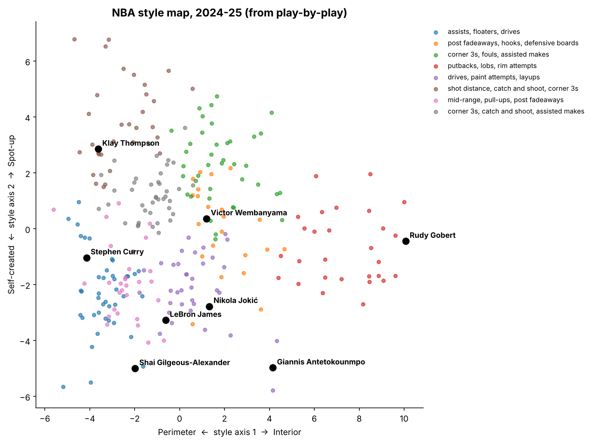

# basketball_ml

Machine learning on NBA data. Each project lives in its own module of the `basketball_ml` package and shares the same data loaders.

| Module | Status | What it does |
| --- | --- | --- |
| [`twins`](#statistical-twins) | Ready | Finds a player's "statistical twin" for a season or a whole career, across every era |
| [`projections`](#career-projections) | Ready | Projects a player's next seasons from what his twins did at the same age |
| [`predictions`](#game-predictions) | Ready | Home win probability for any matchup, from Elo, recent form and rest |
| [`embeddings`](#play-by-play-style) | Ready | Style fingerprints from play-by-play: style twins, archetypes and a style map |

## Installation

```bash
python -m venv .venv && source .venv/bin/activate
pip install -e . pytest
```

### Data

Download the Kaggle dataset [NBA Stats (1947-present)](https://www.kaggle.com/datasets/sumitrodatta/nba-aba-baa-stats) and put `Advanced.csv` in `data/`.

```bash
# with the Kaggle CLI (kaggle.json configured)
kaggle datasets download sumitrodatta/nba-aba-baa-stats -f Advanced.csv -p data --unzip
```

Play-by-play and shot charts come from the public GitHub repository [shufinskiy/nba_data](https://github.com/shufinskiy/nba_data), which covers every season since 1996-97. Game predictions and play-by-play style use these files. They download automatically into `data/pbp/` the first time they are needed (about 140 MB per season).

## Statistical twins


### Method

1. **Data**: Basketball-Reference advanced stats, one row per player and season, since 1979-80. Only seasons with at least 500 minutes are kept.
2. **12 style and efficiency stats**, independent of pace and playing time: TS%, 3-point attempt rate, free throw rate, ORB%, DRB%, AST%, STL%, BLK%, TOV%, USG%, OBPM, DBPM.
3. **Per-season standardization**: each stat becomes a z-score computed within its season, so a 2025 3-point rate can be compared with a 1995 one.
4. **Career profile**: the mean of a player's season z-scores, weighted by minutes played (10,000 career minutes minimum).
5. **Nearest neighbors**: Euclidean distance between profiles, converted into a score out of 100. A score of 100 means an identical profile; an average gap of half a standard deviation per stat gives about 61.

### Usage

```bash
# Career twins
basketball-ml twins "LeBron James" --radar outputs/lebron.png

# Single-season twins (2013 = the 2012-13 season)
basketball-ml twins "LeBron James" --season 2013 -k 5
```

Example output (career):

```
                 player  first_season  last_season  similarity
            Luka Dončić          2019         2026        60.5
           James Harden          2010         2026        53.7
            Dwyane Wade          2004         2019        53.2
Shai Gilgeous-Alexander          2019         2026        50.8
          Magic Johnson          1980         1996        49.3
```

The closest twin to LeBron's 2012-13 season is Michael Jordan's 1988-89 season (57.5/100), followed by Kevin Durant's 2013-14 (55.5/100).

From Python:

```python
from basketball_ml.data import load_advanced
from basketball_ml.twins import standardize_by_season, career_profiles, find_twins, resolve_player

z = standardize_by_season(load_advanced("data/Advanced.csv"))
careers = career_profiles(z)
find_twins(careers, resolve_player(careers, "Victor Wembanyama"), k=5)
```

## Career projections

To project a player, look at the players who looked most like him at the same age and see what they did next.

### Method

1. **Comparables**: the 50 player-seasons closest to the target season (same z-score profile as the twins module), among players of the **same age** whose later season is already known. Only seasons that ended before the target season can be used, so nothing leaks from the future.
2. **What happened next**: for each comparable, the raw change of each stat between that season and the one `h` years later (for example +1.2 BPM).
3. **Starting point**: half the current season, half a 3-season average weighted 5/4/3 by recency and by minutes (as in the Marcel projection system). One noisy season counts less.
4. **Projection**: the starting point plus the similarity-weighted average of the comparables' changes, for 1 to `h` seasons ahead.
5. **80% range**: the 10th and 90th weighted percentiles of the same changes, which show how differently players like him turned out.

### Usage

```bash
# Next three seasons (--last-complete-season skips a season still in progress)
basketball-ml project "Victor Wembanyama" --last-complete-season 2025

# Backtest against simple baselines
basketball-ml backtest --last-complete-season 2025
```

```
Victor Wembanyama, age 21 in 2024-25

          2024-25 (actual)  2025-26 (projected)  2026-27 (projected)  2027-28 (projected)
BPM                  6.500                6.563                7.169                7.587
OBPM                 3.600                3.611                4.044                4.223
DBPM                 2.900                2.969                3.138                3.371
TS%                  0.594                0.593                0.601                0.607
USG%                30.400               31.616               32.455               32.071

BPM 80% range (10th to 90th percentile of the comparables' outcomes):
  2025-26: +4.2 to +8.7
  2026-27: +4.7 to +9.6
  2027-28: +5.4 to +9.5
```

### Backtest

Each of the 3,958 player-seasons from 2010-11 to 2024-25 was projected one season ahead and compared with what actually happened. The comparables beat both baselines on all 13 stats. The baselines are "no change", which repeats the current season, and the "age curve", which adds the average change for that age.

| Mean absolute error | Comparables | Age curve | No change | Actual inside the 80% range |
| --- | --- | --- | --- | --- |
| BPM | **1.29** | 1.43 | 1.47 | 79% |
| OBPM | **1.11** | 1.21 | 1.25 | 80% |
| DBPM | **0.61** | 0.66 | 0.66 | 80% |
| TS% | **0.0296** | 0.0335 | 0.0337 | 78% |
| USG% | **2.07** | 2.14 | 2.19 | 76% |
| AST% | **2.81** | 2.94 | 2.97 | 75% |

What helped and what didn't:

| Change | BPM error | Kept |
| --- | --- | --- |
| Current season as the starting point | 1.37 | |
| **Half current season, half 3-season average** | **1.29** | Yes. The weight was picked on 2011-2017 and holds on 2018-2025 (1.36 → 1.29). |
| Blending the projection with the age curve | 1.37 or worse at every weight | No |
| Matching comparables on play-by-play style instead of box-score stats (2014+) | 1.35 vs 1.33 | No. Style identifies a player but doesn't predict his development better. |

Limits: the 3-point attempt rate range only holds 71% of the time, because its league-wide rise isn't in older comparables. Also, only players who stayed in the league with 500+ minutes have an outcome, so comparables are biased toward careers that continued.

## Game predictions

### Method

1. **Games**: final scores come from the last scoring event of each game's play-by-play, and dates and home and away teams come from the shot charts. Regular season only, from 2012-13 to 2024-25 (15,665 games).
2. **Pre-game features**, computed only from earlier games:
    - **Elo** with a margin-of-victory multiplier, a 100-point home edge, and 25% regression to the mean between seasons, as in FiveThirtyEight's model
    - **Form**: average margin over each team's last 10 games
    - **Season**: season-to-date average margin
    - **Rest**: days since each team's previous game, and back-to-back flags
3. **Models**: logistic regression and gradient boosting on those features, trained on all earlier seasons and tested on the next one.

### Usage

```bash
basketball-ml predict OKC BOS                 # OKC (home) vs BOS: OKC 66%, BOS 34%
basketball-ml predict WAS OKC --next-season   # season opener: ratings regressed, form reset
basketball-ml ratings                         # Elo table after the last season loaded
basketball-ml games-backtest                  # walk-forward evaluation
```

### Backtest

Out of sample from 2017-18 to 2024-25 (9,516 games), with each season predicted by a model trained only on the seasons before it:

| Model | Accuracy | Log loss | Brier score |
| --- | --- | --- | --- |
| Always the home team | 56.0% | 0.687 | 0.247 |
| Elo alone | 64.4% | 0.635 | 0.222 |
| **Logistic regression** | **65.1%** | **0.624** | **0.217** |
| Gradient boosting | 64.7% | 0.627 | 0.219 |

Lower log loss and Brier score are better. Injuries and lineups are not used yet, and they are the main gap with professional models.

## Play-by-play style



Box scores say how much a player produces. Play-by-play shows **how** he plays: where he shoots from, which kind of shots, how often his makes are assisted, how he turns the ball over.

### Method

1. **34 style features** per player-season (300+ shot attempts), all shares or rates, so they don't depend on playing time:
    - **Touches**: field goal attempts, free throws, assists, offensive and defensive rebounds, steals, blocks, turnovers, fouls and fouls drawn, each as a share of the player's total involvement
    - **Shot diet**: share of attempts at the rim, in the paint, from mid-range, from the corners and above the break, plus dunks, layups, putbacks, floaters, hooks, post fadeaways, pull-ups, drives, cuts, lobs and catch-and-shoot jumpers
    - **Shot making**: field goal percentage by zone, shrunk toward the league average
    - **Creation**: share of made shots that were assisted, share of turnovers that were bad passes, average shot distance
2. **Per-season z-scores**, as in the twins module.
3. **Archetypes**: k-means clusters, each named by its three most distinctive traits.
4. **Style map**: the two main axes of the features (PCA). One runs from perimeter to interior, the other from self-created to spot-up.
5. **Compact embedding**: an autoencoder squeezes the 34 features into 8 numbers.

### Usage

```bash
basketball-ml style-twins "Stephen Curry"         # closest styles since 2013-14
basketball-ml archetypes --season 2025 --map docs/style_map_2025.png
basketball-ml style-backtest --advanced data/Advanced.csv
```

```
Closest play-by-play styles to Stephen Curry in 2024-25:

  D'Angelo Russell           2022-23  similarity 60.5
  Dennis Schroder            2019-20  similarity 55.9
  Paul George                2020-21  similarity 54.8
```

### Does it capture a player's identity?

Here's the test: take a player's season, then look among every player's **next** season for the closest one. The question is whether his own next season comes out first. There are 2,254 player-seasons from 2013-14 to 2023-24, each picked from about 270 candidates.

| Vector | Own next season found first | In the top 5 |
| --- | --- | --- |
| Box-score advanced stats (12, from the twins module) | 47.4% | 74.9% |
| **Play-by-play style (34)** | **65.8%** | **87.9%** |
| Both | 69.9% | 90.2% |
| Style compressed to 8 numbers (PCA) | 44.7% | 76.6% |
| Style compressed to 8 numbers (autoencoder) | 41.3% | 72.2% |

Play-by-play style is a much stronger fingerprint than box-score rates. Compressing it to 8 numbers keeps 78% of its variance, but it loses what makes each player unique. That's why style twins use the full 34 features, while the 8-number embedding is kept for maps and clustering.

## Project layout

```
src/basketball_ml/
├── data.py          # Basketball-Reference advanced stats loader
├── pbp.py           # play-by-play and shot chart downloader
├── cli.py           # basketball-ml entry point, one subcommand per module
├── twins/
│   ├── similarity.py  # per-season z-scores, career profiles, nearest neighbors
│   ├── plot.py        # percentile radar charts
│   └── cli.py         # basketball-ml twins
├── projections/
│   ├── comparables.py # same-age comparables, weighted projections and 80% ranges
│   ├── backtest.py    # error against no-change and age-curve baselines
│   └── cli.py         # basketball-ml project / backtest
├── predictions/
│   ├── games.py       # game results, Elo and pre-game features
│   ├── model.py       # win-probability models and walk-forward evaluation
│   └── cli.py         # basketball-ml predict / ratings / games-backtest
└── embeddings/
    ├── features.py    # 34 style features from play-by-play and shot charts
    ├── model.py       # autoencoder, PCA and the identification test
    ├── archetypes.py  # k-means archetypes and the style map
    └── cli.py         # basketball-ml style-twins / archetypes / style-backtest
tests/
```

## Tests

```bash
pytest
```

## Roadmap

- **Better projections**: regress toward the mean, add minutes and availability, and adjust for league-wide trends.
- **Lineup embeddings** learned from who is on the court, as in [NBA2Vec](https://arxiv.org/abs/2302.13386).
- **Injuries and lineups** in game predictions, from who actually played in each game.
- **Tracking stats** (drives, catch & shoot, rim protection) via `nba_api`.
